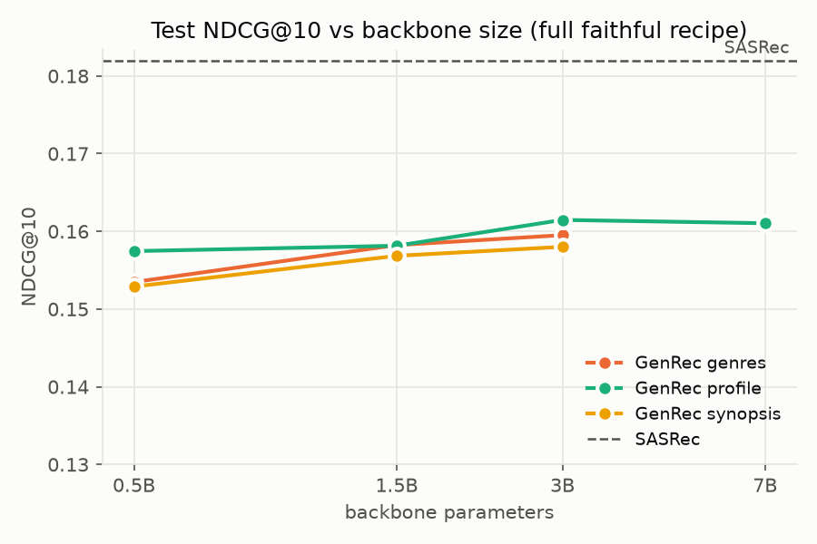

# GenRec on MovieLens

A public-data reproduction of [GenRec: An LLM-Backed Recommendation Ranker at Netflix](https://arxiv.org/html/2608.10257v2) on MovieLens-1M, compared against a tuned SASRec.

**Docs:** [results](docs/results.md) (all metrics, curves, settings) · [plan](docs/plan.md) (remaining runs, next ideas)

**Question:** does the paper's recipe beat a standard sequential recommender on the same data?

**Answer:** no. The best GenRec (Qwen2.5-3B, `profile` prompt) reaches test NDCG@10 **0.1615**, 11% below SASRec's **0.1820**. Scaling to 7B does not close the gap (0.1610).

| Size \ prompt | genres | profile | synopsis |
|---|---|---|---|
| 0.5B | 0.1535 | 0.1575 | 0.1529 |
| 1.5B | 0.1582 | 0.1581 | 0.1569 |
| 3B | 0.1595 | **0.1615** | 0.1580 |
| 7B | – | 0.1610 | – |

Test NDCG@10, full faithful recipe. SASRec (tuned) 0.1820 · Popularity 0.0180. All metrics, training curves and settings: [docs/results.md](docs/results.md).



## Method
```
verbalized history → Qwen2.5 + LoRA → h = LayerNorm(last-token hidden state)
→ score = h · E (one learned vector per movie) → cross-entropy over all 3,706 movies
L = 0.9·L_rank + 0.1·L_lm(target title)
```

| Paper component | Here |
|---|---|
| Verbalized history → LLM → pooled `h` → `h·e_i`, CE over the full catalog | ✅ |
| Context engineering (prompt versions, history length) | ✅ |
| LM loss `β·L_language` on the target title | ✅ β = 0.1 |
| Reward weighting | ✅ tested with ratings (no gain; off) |
| Model-size scaling | ✅ 0.5B → 7B |
| Phase 1 (domain pre-training on Netflix logs) | ❌ no public equivalent; Qwen2.5 used as-is |
| Warmup, grad clip, LayerNorm on `h`, LoRA r=16 | not specified in the paper; ours |

## Prompts
The history is the user's last 20 movies, oldest first. `--prompt` picks what each prompt contains:

| `--prompt` | Adds | ~Tokens | In the results grid |
|---|---|---|---|
| `rating` | title + the user's rating | 270 | – (early runs only) |
| `genres` | + genres per movie | 420 | ✅ |
| `profile` | `genres` + a user line (gender, age, occupation) | 435 | ✅ best |
| `synopsis` | `genres` + the first synopsis sentence (TMDb) for the last 5 movies | 550 | ✅ |

```
rating:   Watched (rating 1-5): Toy Story (1995) 5; Heat (1995) 3; ...\nNext:
genres:   Watched (rating 1-5): Toy Story (1995) [Animation|Children's|Comedy] 5; Heat (1995) [Action|Crime|Thriller] 3; ...\nNext:
profile:  User: male, age 25-34, programmer\nWatched (rating 1-5): Toy Story (1995) [Animation|Children's|Comedy] 5; ...\nNext:
synopsis: Watched (rating 1-5): ...; Heat (1995) [Action|Crime|Thriller] 3 (Obsessive master thief, Neil McCauley leads a top-notch crew ...); ...\nNext:
```

## Data and evaluation
- MovieLens-1M (downloaded automatically from GroupLens); users with ≥5 ratings, ordered by time
- Leave-one-out split: last movie = test, second last = valid
- MRR, HR@10, NDCG@10 over the full catalog, seen movies masked
- Runs are selected by valid NDCG@10 only; test is reported once
- `synopsis` needs synopses from Kaggle "The Movies Dataset" (the error message prints the download commands)

## Reproduce
```bash
uv sync
uv run python common.py                                    # data + Popularity
uv run python sasrec.py --dim 128 --heads 2 --epochs 200 --eval_every 10
uv run python genrec.py --prompt profile --epochs 3 --lm_weight 0.1   # 0.5B
uv run python genrec.py --backbone Qwen/Qwen2.5-3B --prompt profile --epochs 3 --lm_weight 0.1 \
    --lr 1e-4 --warmup 0.1 --grad_ckpt                                 # 1.5B / 3B
uv run python plot.py                                      # runs/ → docs/figures/
```
- `--device {cpu,mps,cuda}` (auto by default); `--grad_ckpt` trades ~30% speed for memory
- Up to 3B fits a 16GB GPU with `--grad_ckpt`; 7B needs an 80GB GPU (`scripts/modal_run.py` runs it on Modal)
- Each run writes `runs/<model>_<time>/` (log, metrics, history, checkpoints); `--resume` continues from a checkpoint

| Size | LoRA LR | Warmup | 3 epochs on an RTX 4060 Ti 16GB |
|---|---|---|---|
| 0.5B | 2e-4 | 5% | ~4 h |
| 1.5B | 1e-4 | 10% | ~12 h |
| 3B | 1e-4 | 10% | ~25 h |
| 7B | 5e-5 | 10% | – (A100 80GB: 9.4 h · H100: 4.2 h) |

## Files
```
common.py  # data, split, metrics, Popularity, run logging
sasrec.py  # SASRec baseline
genrec.py  # GenRec model + training
plot.py    # figures
scripts/   # modal_run.py: run genrec.py on a Cloud GPU (Modal)
docs/      # results.md (full results), plan.md (remaining work)
```

## Notes
- Run-to-run noise is about ±2%; differences under ~4% are not significant
- Qwen2.5-3B is under the Qwen Research License (non-commercial); 0.5B / 1.5B / 7B are Apache 2.0
