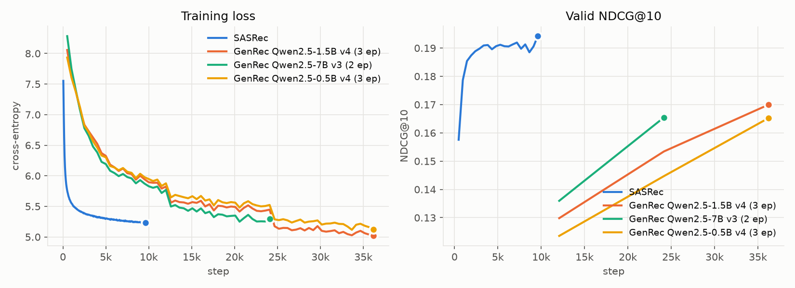

# Results

MovieLens-1M · leave-one-out · test split · full catalog (3,706 items, seen items masked)

| Model | MRR | HR@10 | NDCG@10 | Δ NDCG@10 vs SASRec | Train time | Machine | Cost |
|---|---|---|---|---|---|---|---|
| Popularity | 0.0199 | 0.0369 | 0.0180 | −90% | – | – | – |
| **SASRec (tuned)** | **0.1547** | **0.3209** | **0.1820** | – | 56.2 min | Apple M1 (MPS) | $0 |
| GenRec (Qwen2.5-0.5B, v4 prompt + LM loss) | 0.1353 | 0.2765 | 0.1575 | −13% | 247.1 min | RTX 4060 Ti (Local) | $0 |
| GenRec (Qwen2.5-1.5B, v4 prompt) | 0.1372 | 0.2730 | 0.1581 | −13% | 714.7 min | RTX 4060 Ti (Local) | $0 |
| GenRec (Qwen2.5-7B, v3 prompt, 2 ep) | 0.1369 | 0.2692 | 0.1569 | −14% | 355.2 min | A100 80GB (CUDA) | ~$9.60 |

## Figures
Generated by `uv run python plot.py` from `runs/`.

- Step = one optimizer update; SASRec step = 128 full sequences, GenRec step = 8 prompts → x-axes are not comparable across models.

## Settings
| Item | Config |
|---|---|
| Row selection | best run per model size by **valid** NDCG@10 (test never used to choose) |
| SASRec | d=128, 2 layers, 2 heads, max_len=200, dropout=0.2, lr=1e-3, batch=128, 200 epochs; chosen from a d∈{64,128} × dropout∈{0.2,0.5} (+2 heads) grid by valid |
| GenRec (faithful recipe) | Qwen2.5 + LoRA r=16 (q,k,v,o); last-token h → LayerNorm → h·E (random-init E); CE over full catalog; history 20; prompt v4; LM loss β=0.1; 16 samples/user/epoch; batch 8; 3 epochs; lr 2e-4 (0.5B) / 1e-4 (1.5B, 3B) / 5e-5 (7B) for LoRA, 1e-3 for head; 5–10% warmup → linear decay; grad clip 1.0; bf16 |

## Findings (faithful recipe)
- **Gap:** every GenRec size lands at ~0.157–0.158 test NDCG@10, about 13% below tuned SASRec (0.1820)
- **Size:** 0.5B → 1.5B → 7B is flat on test; valid gains at equal epochs (+7–8% for 7B vs 1.5B) do not carry over
- **Prompts (context engineering):** v2 → v3 (+genres) +4% at both sizes; v4 (+user profile) 0 / +2%; v5 (+synopsis) no gain at +30–60% compute
- **LM loss (β=0.1):** 0.1530 → 0.1575 (+2.9%, within noise; valid +0.7%); kept as paper-faithful
- **Reward (rating) weighting:** 0.1473, no gain — the metric counts the next rating regardless of its value
- **Epochs:** 3 is enough; 8 epochs: valid 0.1700 → 0.1661, test 0.1581 → 0.1558 (train loss 4.2 = memorization)
- **Noise:** two seeds of 0.5B v3 → 0.1500 / 0.1558 (±2%); differences under ~4% are not significant
- **Stability:** warmup + grad clip are required (without them training can collapse to popularity); LoRA LR must drop with size

## Notes
- Backbone choice is ours: the paper uses an internal ~1B–10B LLM with Netflix-specific pretraining (Phase 1); no equivalent here
- SASRec tuning: untuned (d=64, 100 ep) 0.1681 → tuned 0.1820 (+8%); same valid-based selection as GenRec
- Train time includes periodic valid eval, excludes final test eval; Cloud cost = pod time at $0.74/h (RTX 4090) or $1.59/h (A100)
- Timestamps are noisy: 52.9% of consecutive ratings share a timestamp → low ceiling for next-item metrics
